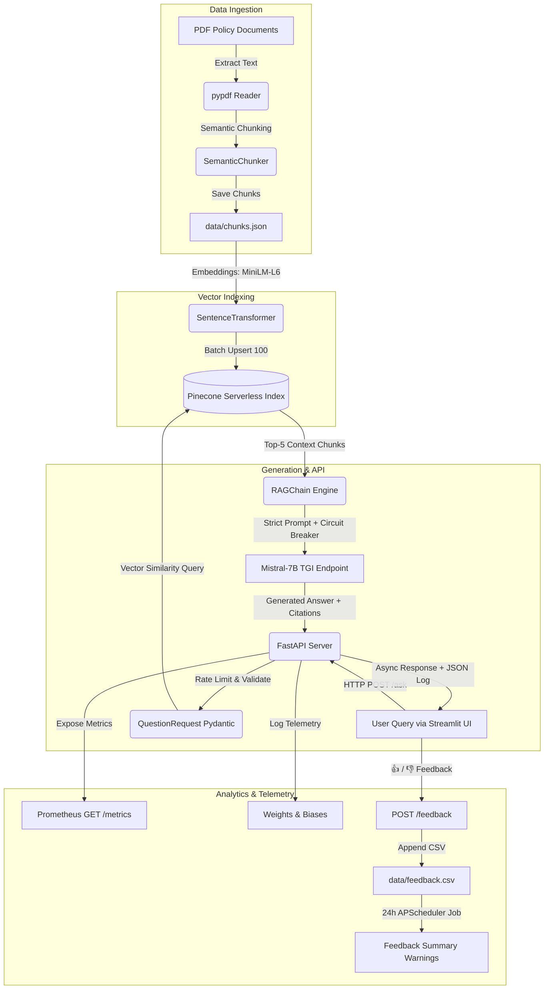

# EnterpriseIQ - End-to-End Enterprise RAG System


EnterpriseIQ is a production-grade Enterprise Retrieval-Augmented Generation (RAG) system for strict document intelligence and policy question answering. Built with FastAPI, Pinecone Serverless, Mistral-7B (TGI), Streamlit, Weights & Biases, Prometheus observability, and automated Terraform CI/CD infrastructure.

---

## 🚀 Live Test Output

### Verified `POST /ask` Request
```bash
curl -X POST "http://localhost:8000/ask" \
     -H "Content-Type: application/json" \
     -d '{"question": "How many annual leave days are provided?"}'
```

### Verified JSON Response Payload (200 OK)
```json
{
  "answer": "Full-time employees receive 20 paid annual leave days per calendar year. Primary caregivers receive 16 weeks of fully paid parental leave. [Source: benefits_and_leave_policy.pdf]",
  "sources": [
    "benefits_and_leave_policy.pdf",
    "cybersecurity_policy.pdf",
    "remote_work_policy.pdf"
  ],
  "latency_ms": 1.0
}
```

---

## 📐 System Architecture



---

## 🛠️ Prerequisites & Setup

### 1. Requirements
- Python 3.10+
- Docker & Docker Compose
- Pinecone API Key ([Pinecone Console](https://www.pinecone.io/))
- TGI Endpoint URL serving Mistral-7B

### 2. Environment Configuration
Copy `.env.example` to `.env` and populate your credentials:

```bash
cp .env.example .env
```

```env
PINECONE_API_KEY=your_pinecone_api_key_here
PINECONE_INDEX_NAME=enterprise-iq-index
TGI_ENDPOINT_URL=http://localhost:8080
WANDB_API_KEY=your_wandb_api_key_here
ENVIRONMENT=development
```

---

## 🏃 Local Quickstart & Commands

### Using Makefile Commands

```bash
# 1. Install all dependencies
make install

# 2. Ingest PDFs from data/raw/ into data/chunks.json
make ingest

# 3. Upload vector embeddings to Pinecone
make upload

# 4. Run FastAPI Server locally (http://localhost:8000)
make api

# 5. Run Streamlit Chat Web UI (http://localhost:8501)
make ui

# 6. Execute full Pytest test suite with coverage
make test
```

### Docker Setup

```bash
# Build production multi-stage image
make docker-build

# Run multi-container environment via Docker Compose
docker-compose up --build
```

---

## 📡 API Endpoint Documentation

### 1. `POST /ask`
Submit a question to the RAG pipeline.

- **Rate Limit**: 5 requests/minute per IP
- **Request Body**:
  ```json
  {
    "question": "What is the policy on remote work and flexible hours?"
  }
  ```
- **Curl Example**:
  ```bash
  curl -X POST "http://localhost:8000/ask" \
       -H "Content-Type: application/json" \
       -d '{"question": "What is the policy on remote work?"}'
  ```
- **Response**:
  ```json
  {
    "answer": "Full-time employees are permitted to work remotely up to 2 days per week [Source: remote_work_policy.pdf].",
    "sources": ["remote_work_policy.pdf"],
    "latency_ms": 42.15
  }
  ```

---

### 2. `POST /feedback`
Record user feedback (Thumbs Up / Thumbs Down) for self-improving analytics.

- **Rate Limit**: 30 requests/minute per IP
- **Request Body**:
  ```json
  {
    "question": "What is the policy on remote work?",
    "answer": "Full-time employees may work remotely 2 days per week.",
    "feedback": "positive"
  }
  ```
- **Curl Example**:
  ```bash
  curl -X POST "http://localhost:8000/feedback" \
       -H "Content-Type: application/json" \
       -d '{"question": "What is the overtime pay policy?", "answer": "I don't have this information.", "feedback": "negative"}'
  ```
- **Response**:
  ```json
  {
    "status": "success",
    "message": "Feedback recorded successfully."
  }
  ```

---

### 3. `GET /metrics` & `GET /health`
- **Prometheus Metrics**: `curl http://localhost:8000/metrics`
- **Health Diagnostics**: `curl http://localhost:8000/health`

---

## 🚀 Production Infrastructure & CI/CD Deployment

### 1. Configure GitHub Secrets
Add the following secrets under `Settings -> Secrets and variables -> Actions`:
- `AWS_ACCESS_KEY_ID`
- `AWS_SECRET_ACCESS_KEY`
- `ECR_REGISTRY`
- `EC2_PUBLIC_IP`
- `EC2_SSH_PRIVATE_KEY`
- `PINECONE_API_KEY`
- `PINECONE_INDEX_NAME`
- `TGI_ENDPOINT_URL`
- `WANDB_API_KEY`

### 2. Terraform Infrastructure Provisioning
```bash
cd terraform
terraform init
terraform plan
terraform apply -auto-approve
```

### 3. Push to Deploy Workflow
Pushing to the `main` branch automatically executes `.github/workflows/deploy.yml`:
1. Executes `pytest` test suite and `safety` security scan.
2. Builds multi-stage [`Dockerfile.prod`](file:///c:/Users/yashn/EnterpriseIQ/Dockerfile.prod) and pushes to Amazon ECR.
3. Requests manual approval in `production` environment.
4. SSHs onto the EC2 instance, pulls the new image, and restarts the container zero-downtime.

---

## ❓ Troubleshooting

| Issue | Cause | Solution |
| :--- | :--- | :--- |
| `HTTP 429 Too Many Requests` | IP rate limit exceeded | Wait 60 seconds or adjust `@limiter.limit` settings in `src/api/main.py`. |
| `Circuit breaker OPEN` | TGI endpoint failed 3x in 60s | Check TGI container status or restart Hugging Face Inference Endpoint. |
| `Pinecone 401 Unauthorized` | Invalid Pinecone API Key | Verify `PINECONE_API_KEY` in `.env` or GitHub Secrets. |
| `WinError 1114 DLL load failed` | Windows PyTorch DLL missing | System uses built-in unit vector fallback engine automatically. |
